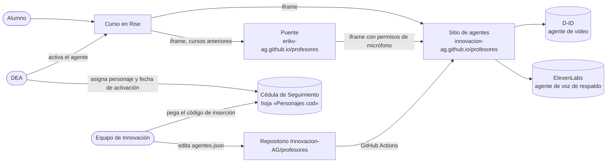
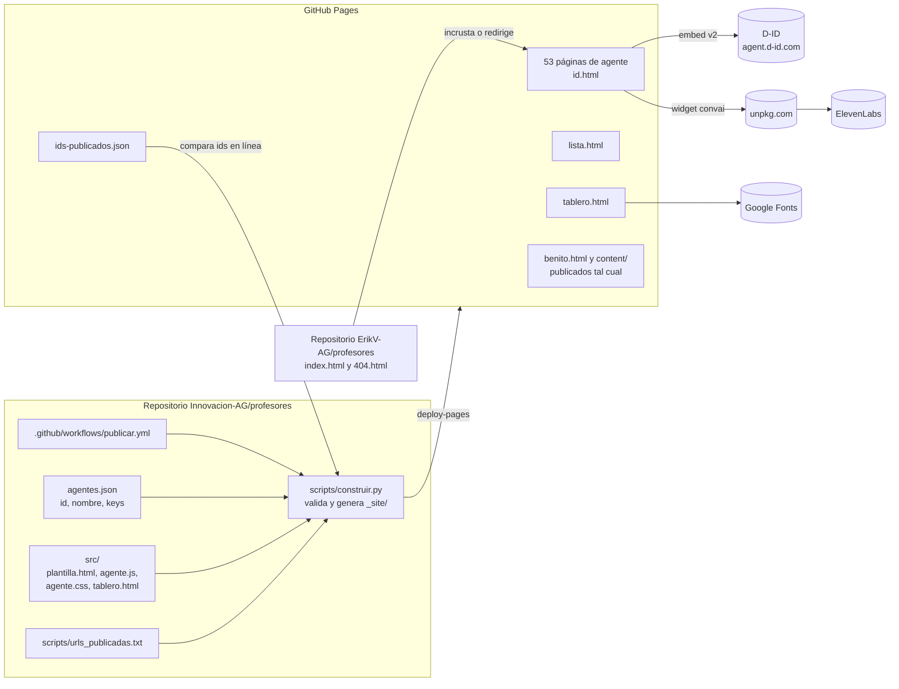
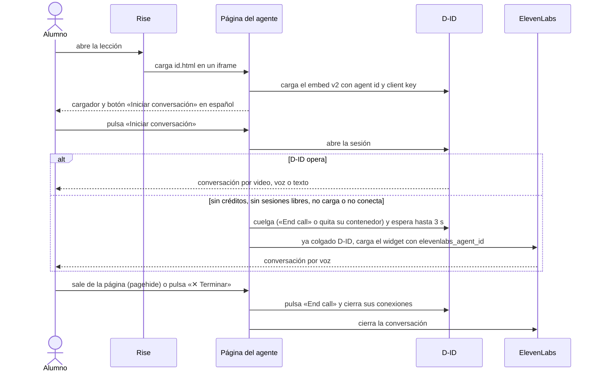
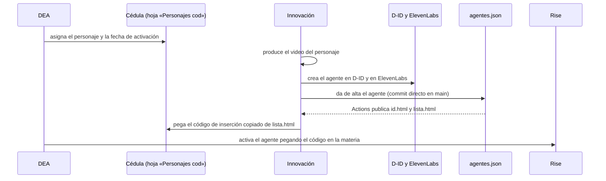

# Blueprint: Profesores

Profesores virtuales (Alan Turing, Marie Curie, Adam Smith…) con los que el
alumno conversa por voz o texto dentro de los cursos de Articulate Rise 360
(Rise). Cada agente es una página estática publicada en GitHub Pages que
Rise inserta por iframe. El agente principal es de D-ID; si D-ID no opera,
la página cambia sola a un agente de voz de ElevenLabs.

- Área usuaria: DEA, que asigna los personajes y da seguimiento en la
  Cédula de Seguimiento de materias (ver [Plan de personajes](#4-plan-de-personajes)).
- Patrocinio: DEA.
- Cliente: interno. UCC y GRG son clientes de algunos diplomados (ids
  `diplomadoIA-*-UCC_*` y `diplomadoIA-*-GRG_*`).
- Responsable: @CoriaAlx. Suplente: @rodrig317-cpu. Supervisor y revisor: @ErikV-AG.
- Usuarios: PENDIENTE: ¿cuántos cursos y alumnos usan hoy los agentes?
- Criterio de éxito: PENDIENTE: ¿cómo se mide que el proyecto cumple su objetivo?
- `benito.html` ya no sigue en uso y `content/` (export de Rise «Prueba») no
  tiene uso identificado; los dos se publican tal cual. PENDIENTE: ¿qué es
  `content/` y quién decide si `benito.html` y `content/` se retiran?

## 1. Contexto (C4, nivel 1)

## 2. Contenedores (C4, nivel 2)

## 3. Flujo principal

La página registra cada conexión y micrófono que se abre (script inicial
de `src/plantilla.html`) para cerrar a la fuerza solo las de D-ID,
reconocidas por su destino. El embed de D-ID no expone una función para
colgar. Detalle y límites en [operación › Cierre de sesiones](operacion.md#cierre-de-sesiones)
y en la [decisión 0007](decisiones/0007-se-cuelga-d-id-antes-del-respaldo-y-al-salir-sin-campo-tipo.md).

Si el agente no tiene `elevenlabs_agent_id` (13 de 53), la página muestra
el chat de texto de D-ID o el aviso «El profesor no está disponible por el
momento».

## 4. Plan de personajes

El plan de personajes vive fuera del repositorio, en la
[Cédula de Seguimiento de materias](https://docs.google.com/spreadsheets/d/1I9YYzEdpFYIqBMzy-pgykguDBPYmFZ15uAWOYCB8ObA/edit#gid=764442467)
de DEA, hoja «Personajes cod». Cada fila es una materia con su personaje,
su fecha de activación (columna «ACTIVACIÓN (INICIO EN CAMPUS)») y su
código de inserción (columna «Código de insersión»).

- **La Cédula es la fuente del plan**: qué personaje lleva cada materia y
  cuándo se activa.
- **`agentes.json` es la fuente de lo publicado**: qué agentes existen en el
  sitio y con qué ids de D-ID y ElevenLabs.

Una materia puede estar en la Cédula sin agente publicado todavía. Un agente
publicado sin fila en la Cédula es un hueco en el seguimiento de DEA.
Ver la [decisión 0006](decisiones/0006-la-cedula-de-dea-es-la-fuente-del-plan-de-personajes-y-agentes-json-la-de-lo-publicado.md).

## 5. Dependencias externas

| Servicio | Uso | Cuenta titular | Plan | Ubicación de la credencial |
| --- | --- | --- | --- | --- |
| D-ID | Agentes de video (embed v2). Las client keys solo funcionan desde los dominios permitidos: `innovacion-ag.github.io` y `erikv-ag.github.io`. | Cuenta «Proyectos Innovación». PENDIENTE: ¿quién es el titular? | PENDIENTE: ¿qué plan? Los créditos se renuevan el día 18 de cada mes. | Gestor de contraseñas del área, grupo profesores |
| ElevenLabs | Agente de voz de respaldo (widget `@elevenlabs/convai-widget-embed`). 40 de 53 agentes lo tienen. | Cuenta del área. PENDIENTE: ¿quién es el titular? | PENDIENTE: ¿qué plan y cuándo se renueva? | Gestor de contraseñas del área, grupo profesores |
| HeyGen | Videos de presentación de cada agente. No aparece en el código. | PENDIENTE: ¿cuenta del área titular? | PENDIENTE: ¿qué plan? | Gestor de contraseñas del área, grupo profesores |
| GitHub Pages y Actions | Construcción y publicación del sitio. | Organización Innovacion-AG | PENDIENTE: ¿plan de la organización? | Sin credenciales propias; Actions usa el token del flujo. |
| unpkg.com | Entrega el script del widget de ElevenLabs. | Servicio público | Gratuito | No aplica |
| Google Fonts | Tipografías de `tablero.html`. | Servicio público | Gratuito | No aplica |
| Vimeo | Video de introducción de `benito.html`, página que ya no sigue en uso. | PENDIENTE: ¿cuenta titular del video? | PENDIENTE: ¿qué plan? | Gestor de contraseñas del área, grupo profesores |
| Google Sheets | Cédula de Seguimiento de materias de DEA, hoja «Personajes cod»: plan de personajes y códigos de inserción. Fuera de este repositorio. | DEA | Google Workspace de la institución | Acceso con la cuenta institucional |
| Articulate Rise 360 | Cursos que insertan los agentes por iframe. El montaje lo hace DEA. | PENDIENTE: ¿cuenta de DEA? | PENDIENTE | Fuera de este repositorio |

## 6. Entornos

| Entorno | Dirección | Despliegue |
| --- | --- | --- |
| Producción | https://innovacion-ag.github.io/profesores/ (`lista.html`, `tablero.html`, `<id>.html`) | GitHub Actions (`publicar.yml`) en cada push a `main`, solo si la validación pasa. |
| Puente | https://erikv-ag.github.io/profesores/ | GitHub Pages desde la rama `main` de `ErikV-AG/profesores`. Dentro de un iframe incrusta la página nueva; abierta directo, redirige. |
| Revisión de PR | Checks del PR | `publicar.yml` valida y construye sin publicar. |
| Prueba en el dominio real | https://innovacion-ag.github.io/profesores/prueba/ (`iframes.html` y una página por agente de prueba) | Solo mientras exista la carpeta `prueba/` en `main`: se publica tal cual junto con producción, con un aviso. Se genera con `construir.py --prueba` desde la rama del cambio y se borra al terminar la prueba. |
| Local | http://localhost:8000/lista.html | `python3 scripts/servidor.py`. D-ID no conecta desde `localhost`. |

## 7. Datos

- El sitio no guarda datos: no hay formularios, base de datos ni
  almacenamiento en el navegador.
- La voz y el texto del alumno se envían
  directamente desde su navegador a D-ID y, en el respaldo, a ElevenLabs.
  Son datos personales de alumnos procesados por terceros.
- El seguimiento de la cobertura legal de ese procesamiento está en el
  registro RAID de la bitácora ejecutiva.
- PENDIENTE: ¿D-ID y ElevenLabs guardan las conversaciones según la
  configuración de cada agente?
- `agentes.json` contiene client keys de D-ID. Son llaves de navegador
  protegidas por la lista de dominios permitidos y se publican en cada
  página por diseño.

## 8. Riesgos y deuda técnica

Los riesgos y la deuda técnica del proyecto se registran en el registro
RAID de la bitácora ejecutiva (acceso interno). Para consultarlo o
agregar uno, preguntar en `#proj-profesores`. La deuda técnica que tiene
trabajo concreto se registra además como incidencia con la etiqueta
`deuda-tecnica`.
